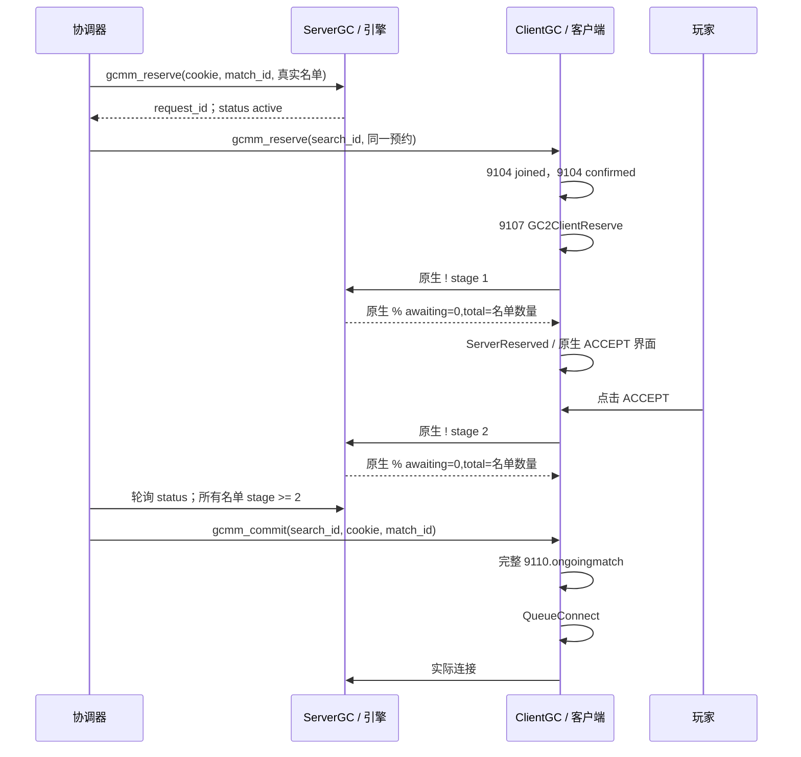

# GCMM 开发者协议

本页是 `gcmm/1` Source RCON 原生控制 profile 的实现契约，定义外部协调器、本地 ClientGC 和本地 ServerGC 之间的边界。

较早的 MM/1 笔记描述了另一套分布式匹配设计。它们不是 GCMM 契约，也不能证明那套早期分布式设计已经实现。

## 范围与不变量

GCMM v1 保留 CS:GO 共享消息 ID 和 protobuf 形状，在客户端和服务器原生路径外增加一个已认证控制平面：

```text
协调器 -- Source RCON --> ClientGC -- 原生GC消息 --> 旧版客户端
协调器 -- Source RCON --> ServerGC -- 原生引擎接口 --> srcds
旧版客户端 -- 无连接预约检查 --> srcds
```

profile 的不变量如下：

- `gcmm.enabled` 独立存在，默认关闭；Source RCON 需要单独启用。
- 协调器使用真实的搜索中账号 ID，不创建伪造名单项。
- 服务器拥有原生预约 cookie、Q 载荷、名单和准备阶段。
- 客户端不写原生准备阶段，也不发送手动 `connect` 后备命令。
- 只有协调器从服务器权威名单读取到所有成员至少处于阶段 2 后，才能执行 `gcmm_commit`。
- 原生引擎调用在服务器回调/引擎线程执行；RCON 工作线程只排队任务或读取有界快照。
- 相同所有者的重复命令保持幂等；过期所有权和替换请求被拒绝。
- 当前原生服务器适配器只有在确认精确的 Windows x86 build 1575 引擎后才启用，否则安全退出。

当前运行时验证是在 build 1575 上使用产品化 API 和参考协调器完成的一个真实账号流程。十个真实客户端和生产环境分布式匹配仍需单独验收。

## 传输契约

GCMM 使用现有的已认证 Source RCON 二进制传输，不引入 HTTP、WebSocket、TLS 会话发现、新 socket 或新 protobuf 消息。

RCON 命令不区分大小写，键名使用小写。客户端命令复用现有 tokenizer，服务器命令严格解析。每个已认证命令对应一个响应。Source RCON 长度字段上限为 4096 字节；扣除 request ID、包类型和两个结尾字节后，**完整响应正文最多为 4086 个 UTF-8 字节**，其中包含 `OK ` 或 `ERR `。超长 GCMM 响应应返回 `ERR response_too_large ...` 等短错误，不能截断一个 `OK` JSON 对象。

成功：

```text
OK {"protocol":"gcmm/1","role":"client",...}
```

错误：

```text
ERR <stable_code> <message>
```

两个角色统一使用以下 JSON 表示：

| 值 | 表示方式 |
| --- | --- |
| `uint64` 标识 | JSON 十进制字符串 |
| reservation cookie | 十六进制 JSON 字符串 |
| match ID | 十六进制 JSON 字符串 |
| `search_id` | 十进制 JSON 字符串 |
| `request_id` | 十进制 JSON 字符串 |
| 账号 ID | `uint32` 范围内的 JSON 数字 |
| 命令名 | 不区分大小写 |
| 键名 | 小写 |

未知额外参数、重复键、溢出、格式错误的账号列表、过期所有权，以及试图替换活动预约的请求都必须失败，并且不得部分更新状态。

## 客户端状态和命令

### 状态来源

客户端在 GC worker 中捕获原生 9101 和 9102。有效原生 9101 使进程内单调 `search_id` 增加，进入 `searching`，并清除之前显式的 GCMM 比赛状态。格式错误的 protobuf 或无效本地/party 名单不会创建新搜索。

`abandon` 未设置或为 0 的普通原生 9102 会清除提交前的搜索/预约。提交之后，同样的普通 stop 可能属于原生连接交接，因此保留 committed 载荷。**明确的原生放弃（`9102.abandon != 0`）会清除 reserved/committed 的 GCMM 状态和诊断 ongoing 状态**，进入 `idle`，并发布不带 ongoing 的完整 Hello。新搜索、所有者匹配的取消和成功的旧版 `mm_abandon` 也会清除持有比赛。

这些操作在 GC worker 上串行执行。stop 先被处理时，预约已清除，随后 commit 因所有权过期失败；commit 先被处理时，普通交接 stop 会保留它，但明确 abandon 仍会清除。协调器必须继续检查所有权，不能认为一次 status 读取锁定了之后命令的执行时点。

`gcmm_status` 是协调器的状态 API：

```json
{
  "protocol": "gcmm/1",
  "role": "client",
  "enabled": true,
  "steam_id": "76561198265685624",
  "account_id": 305419896,
  "search_id": "12",
  "phase": "searching",
  "request": {
    "account_ids": [305419896],
    "game_type": 462552584,
    "client_version": 13881
  },
  "reservation": null
}
```

`phase` 为 `idle`、`searching`、`reserved` 或 `committed`。持有预约时，`reservation` 包含 `reservationid`、`match_id`、`accounts`、`ip`、`port`、`map`、`game_type` 和 `serverid`。初始 idle 搜索 ID 为十进制字符串 `"0"`，变更命令需要非零的当前所有者。搜索 ID 只在当前进程内单调递增，不在进程重启间保持全局单调。

协调器必须轮询这个 API，而不是解析诊断日志。

### 客户端预约

```text
gcmm_reserve search_id=N reservationid=N match_id=N accounts=id,... ip=a.b.c.d port=N serverid=N map=name game_type=N [server_address=ip:port] [server_version=13881]
```

该命令只接受当前活动搜索的所有者。它要求非零标识、有效单播 IPv4 地址、非零端口、服务器 ID，以及本地账号和其 party 中每个账号组成的完整真实名单；名单包含 1 到 64 个唯一且非零的 `uint32` 账号，并且必须包含本地账号。`map` 必须由 ASCII 字母、数字、`_`、`-` 或 `/` 组成，长度为 1 到 128。可选的 `server_address` 必须与 `ip:port` 一致。v1 原生 ACCEPT profile 要求请求的和提供的 `game_type` 低 4 位都是 `8`（`game_type & 0xf == 8`）；完整数值可以不同。如果提供 `server_version`，它必须与原生客户端请求版本完全一致；如果省略，则使用 `request.client_version`。

客户端严格按以下顺序发送原生消息：

```text
9104 matchmaking=1（加入/搜索状态）
9104 matchmaking=4（比赛已确认）
9107 GC2ClientReserve（持有的完整预约载荷）
```

然后进入 `reserved`。同一搜索的完全相同命令保持幂等；同一搜索的不同载荷产生状态冲突。该命令不会设置服务器阶段。

### 客户端提交

```text
gcmm_commit search_id=N reservationid=N match_id=N
```

客户端要求当前 `search_id`、cookie 和 match ID 与持有的预约完全匹配。命令没有调用者提供的 stage 或名单覆盖参数。协调器必须先从服务器 API 证明权威名单中的每个成员都达到阶段 2 或更高。

命令通过后，客户端发送完整的 `9110.ongoingmatch`，进入 `committed`，并让原生客户端会话消费排队的连接。普通 hello 刷新会在 committed 期间保留显式 GCMM ongoing 载荷。相同 commit 重复发送时保持幂等。

`gcmm_commit` 是本地 handoff 操作。它成功并不能证明任何远程客户端已经接受；只有服务器权威名单阶段能提供该证据。

### 客户端取消

```text
gcmm_cancel search_id=N
```

必须显式提供 search ID。取消会清除 reserved 或 committed 状态，发送 matchmaking 状态 0，并发送不带 GCMM ongoing 数据的完整 hello。对当前已取消所有者重复取消时保持幂等。成功执行旧版 `mm_abandon` 也会清除持有的 GCMM 比赛。诊断 `mm_*` 命令不属于本契约。

## 服务器状态和命令

服务器路由提供：

```text
gcmm_status
gcmm_reserve reservationid=N match_id=N accounts=id,...
gcmm_release reservationid=N match_id=N
```

`gcmm_status` 返回有界 JSON 快照：

```json
{
  "protocol": "gcmm/1",
  "role": "server",
  "enabled": true,
  "initialized": true,
  "request_id": "1",
  "last_result": true,
  "server_steamid": "76561198265685624",
  "cookie": "0x1122334455667801",
  "match_id": "0x0a0b0d01",
  "queue": "Q1122334455667801,a0b0d01,1:[12345678]",
  "roster_count": 1,
  "expected_humans": 1,
  "minimum_stage": 2,
  "accepted": 1,
  "matches_request": true,
  "active": true,
  "all_accepted": true,
  "roster": [{ "account_id": 305419896, "stage": 2 }]
}
```

禁用或不支持时，发现命令仍应清楚报告 protocol、role、enabled 和初始化/错误状态；变更命令必须拒绝。

`gcmm_reserve` 解析严格的 Q 预约载荷，并把公开原生预约调用排到引擎线程。立即响应是排队确认：

```text
OK {"protocol":"gcmm/1","role":"server","request_id":"1","queued":true}
```

协调器必须使用相同的 `request_id` 轮询 `gcmm_status`。只有当 `last_result` 是严格的 JSON 布尔值 `true`、cookie 和 match ID 与请求的所有者完全一致、名单是完整的实际真实名单，并且 `active` 是严格的 JSON 布尔值 `true` 时，才能继续。服务器拒绝替换其他活动所有者；同一所有者和完全相同的请求保持幂等。本契约始终将该原生状态称为预约。

`gcmm_release` 为精确 cookie 和 match ID 排队一个经过所有权校验的原生释放操作。原生 `Qcookie,match,0` 成功后，`active` 会立即变为 false，但引擎可能稍后才清除 cookie 和 queue；清理不能要求这些字段立即变为零。清理应等待相同 release `request_id` 的严格 `last_result:true` 和 `active:false`；所有者发生变化也表示旧所有者已经不再占用预约。对于已完成所有者且状态 inactive 的重复 release，如果旧 cookie/queue 仍在或状态已经为空，都必须保持幂等。协调器在取消、超时或失败时只能释放自己拥有的预约。

原生服务器适配器有意保持狭窄：它先验证精确安装引擎哈希和 `VEngineServer023` 预约入口，再调用原生接口。不支持的 build 安全退出。适配器读取 cookie、Q 载荷和名单阶段用于 status，但从不写入阶段值。

## 原生消息与阶段顺序

已验证的原生路径围绕 9107 预约进行两阶段准备交换：



服务器 `%` 回复中的 `awaiting=127` 是原生失败哨兵值，不是还缺 127 名玩家。成功阶段回复为 `awaiting=0`，并带有名单总数。协调器以服务器 JSON 名单阶段作为 commit 的权威门槛。

客户端不会从 `9104 matchmaking=4` 推断所有人已接受。这个消息是 UI/匹配状态更新；接受状态由玩家操作原生 ACCEPT 后的服务器预约检查建立。

## 参考协调器行为

参考协调器使用 Python 3.10+ 标准库实现。它接受一个服务器 RCON 端点和可重复的客户端 RCON 端点；密码从环境变量读取，不得提交真实密码。该参考 profile 仅支持 solo：每个选中的客户端必须代表一个本地账号，包含额外账号的 party 请求必须明确失败。

默认目标是十人。`--players 1` 是明确的本地冒烟 profile。默认时间值为 RPC 超时 4 秒、准备超时 12 秒、接受超时 90 秒和轮询间隔 0.25 秒。协调器必须：

1. 轮询客户端 `gcmm_status`，选择指定数量的不同真实搜索账号；
2. 生成随机的非零 `uint64` cookie 和 match ID；
3. 先预约原生服务器，并核对返回的所有者和完整实际真实名单；
4. 并发向所有选中的客户端发送准备预约，保留每一个 future；准备失败时，必须先等待所有 future 完成，再清理所有者；
5. 轮询同一服务器所有者，直到每个名单成员达到阶段 2，否则明确失败；
6. 在 commit 前立即重新校验服务器所有者、完整名单、活动预约以及每个客户端所有者；
7. 提交所有客户端；如果发生部分提交，清理已经提交的客户端和其余客户端预约，然后释放服务器所有者；
8. 取消、状态过期、超时或失败时，只取消客户端，只释放自己拥有的服务器预约；等待异步释放结果，并把不可达端点报告为 `cleanup incomplete`；
9. 不自动接受，也不创建伪造账号。

使用 `--once` 成功完成时，协调器核对 committed 状态，并保留成功的原生预约供客户端连接。连续模式在成功后等待服务器可用和下一批 cohort；它不管理整场比赛或比赛结束生命周期。mock 或多客户端模拟可以测试命令顺序和失败处理，但不能作为十个真实客户端的验收结论。

## 错误和所有权行为

协调器应把 `ERR` 视为稳定机器可读错误码加面向人的消息。至少需要区分协议禁用/不支持、参数格式错误、过期 `search_id`、过期 cookie 或 match ID、预约所有权冲突、重复/替换预约，以及无效或过期原生预约。

服务器错误不得被转换为客户端成功 commit。事务失败时，协调器只能取消自己控制的客户端，只能释放自己拥有的服务器预约；不得清除无关活动预约，也不得使用旧 search ID 发送之后的 `9110`。

## 测试与验证边界

实现测试覆盖命令构造、字段校验、幂等状态保留、清除行为和 RCON 路由。原生运行时证据包括：

- build 1575 真实客户端显示原生 ACCEPT 确认框；
- 真实用户点击 ACCEPT；
- 服务器阶段 1 和阶段 2 的无连接检查均返回 `awaiting=0`；
- 只有阶段 2 后才发送 `9110.ongoingmatch`；
- 原生连接队列被消费并自动进入 `de_dust2`；
- 没有发送手动 `connect` 命令。

这些事实只建立单账号流程。十个真实客户端、完整 party 行为、生产发现、比赛结果上报、协调器故障后的重试，以及分布式故障转移仍是后续验证工作。

安装和命令示例见[GCMM 协议](/zh/user/gcmm)。